| Name                 | NRP        | Kelas |
| -------------------- | ---------- | ----- |
| Ahmad Fakhrul Bawani | 5025251143 | B     |

> [!IMPORTANT]
> Remember to use the IP prefix allocation provided earlier for this pre-lab assignment (pra-praktikan) and for future ones.
> Access it on [Linktree](https://linktr.ee/jarkom)

> [!TIP]
> **Due Date : `26th November 2026, 23.00 WIB`**

#### Put your GNS3 Project files here (gdrive or github upload)!

`Put file URL here`


---

## Bagian A - Perencanaan: VLSM, Interface, dan Routing Table

> [!NOTE]
> Bagian ini dikerjakan di atas kertas (boleh tulisan tangan yang difoto dengan jelas) dan menjadi acuan alamat untuk Bagian B, C, dan D.
>
> _This section is to be completed on paper (handwritten work is acceptable, provided it is clearly photographed) and will serve as a reference for Sections B, C, and D._

### Problem A.1 - Perhitungan VLSM untuk Seluruh Segmen

> Sebuah kompleks laboratorium memperoleh satu alokasi alamat `[IP Prefix].20.0/24` untuk melayani tiga ruang, yaitu Ruang Kelas IF-106 (±50 perangkat), Ruang Kelas IF-105 (±40 perangkat), dan Ruang Dosen (±10 perangkat). Router setiap ruang dihubungkan melalui tiga link point-to-point (R1–R2, R2–R3, dan R3–R1), serta melalui dua shared backbone segment (Backbone A dan Backbone B) yang dirancang dapat menampung hingga enam router. Sisa alokasi dicadangkan untuk penambahan Ruang Baca (±35 perangkat) pada Bagian D. Hitunglah pembagian VLSM untuk seluruh segmen tersebut.
>
> _A laboratory complex receives a single allocation, [IP Prefix].20.0/24, to serve three rooms: Classroom IF-106 (±50 devices), Classroom IF-105 (±40 devices), and the Lecturer Room (±10 devices). The routers of each room are connected through three point-to-point links (R1–R2, R2–R3, and R3–R1) and through two shared backbone segments (Backbone A and Backbone B) designed to accommodate up to six routers. The remaining space is reserved for the Reading Room (±35 devices) added in Part D. Calculate the VLSM division for all segments._

**Langkah Kerja:**

> Silahkan mengikuti langkah kerja yang diberikan dalam soal pra-praktikum modul 4 di bagian Problem A.1
>
> _Please follow the work steps given in the module 4 pre-practicum questions in the Problem A.1 section_

**Answer: (fill the table and provide your VLSM calculation by hand)**

| No  | Segmen                | Kebutuhan Host  | Prefix (/xx) | Network Address | Broadcast Address |
| --- | --------------------- | --------------- | ------------ | --------------- | ----------------- |
| 1   | IF-106                | ±50             | /26          | 10.127.20.128   | 10.127.20.191     |
| 2   | IF-105                | ±40             | /26          | 10.127.20.64    | 10.127.20.127     |
| 3   | Ruang Dosen           | ±10             | /28          | 10.127.20.0     | 10.127.20.15      |
| 4   | Backbone A            | hingga 6 router | /29          | 10.127.20.32    | 10.127.20.39      |
| 5   | Backbone B            | hingga 6 router | /29          | 10.127.20.40    | 10.127.20.47      |
| 6   | Link R1–R2            | 2               | /30          | 10.127.20.16    | 10.127.20.19      |
| 7   | Link R2–R3            | 2               | /30          | 10.127.20.20    | 10.127.20.23      |
| 8   | Link R3–R1            | 2               | /30          | 10.127.20.24    | 10.127.20.27      |
| 9   | Ruang Baca (cadangan) | ±35             | /26          | 10.127.20.192   | 10.127.20.255     |

<div align="center">
    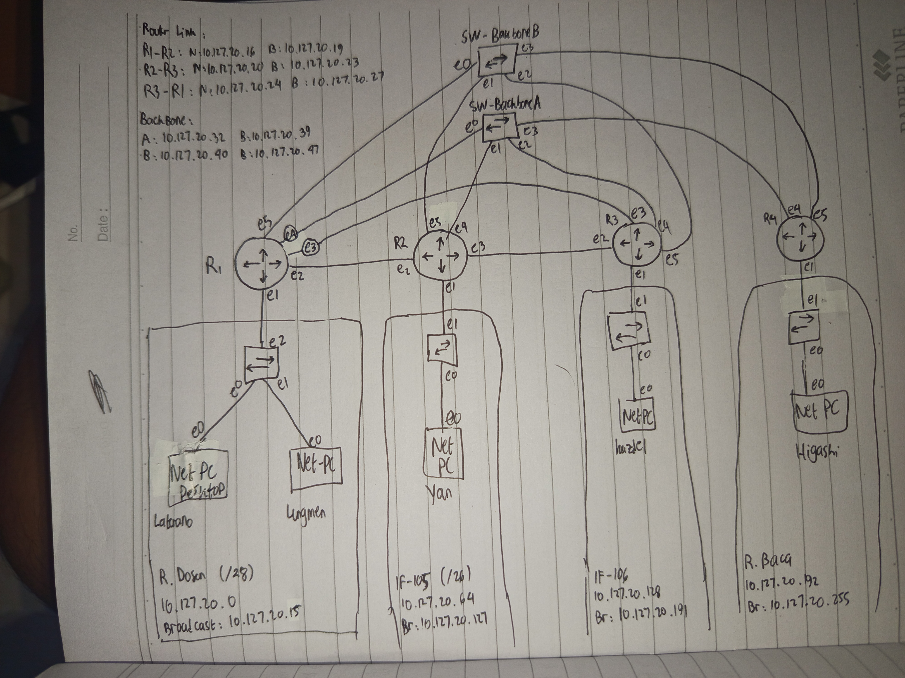
    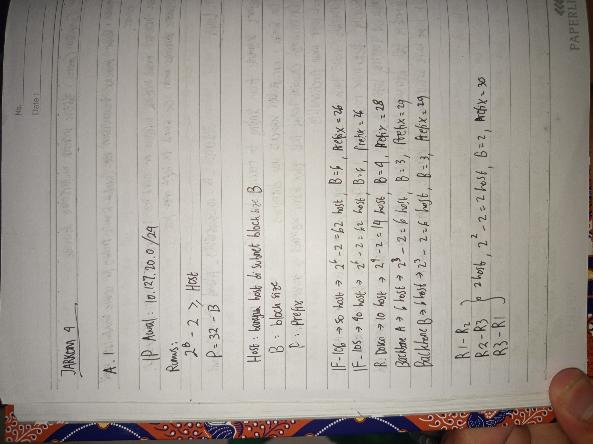
</div>

### Problem A.2 - Rencana Interface dan Routing Table: Chain Topology

> Pada tahap awal (Bagian B), ketiga router disusun dalam chain topology: R1 terhubung ke R2 melalui link R1–R2, dan R2 terhubung ke R3 melalui link R2–R3. Link R3–R1 belum dipasang. Susunlah rencana alamat setiap interface dan routing table yang seharusnya terbentuk pada setiap router.
>
> _In the initial stage (Part B), the three routers are arranged in a chain topology: R1 connects to R2 through link R1–R2, and R2 connects to R3 through link R2–R3. Link R3–R1 is not installed yet. Prepare the address plan for every interface and the routing table that should be formed on each router._

**Langkah Kerja:**

> Silahkan mengikuti langkah kerja yang diberikan dalam soal pra-praktikum modul 4 di bagian Problem A.2
>
> _Please follow the work steps given in the module 4 pre-practicum questions in the Problem A.2 section_

**Answer - Tabel Alokasi Interface (rencana):**

| Router | ether1 (LAN)  | ether2        | ether3           |
| ------ | ------------- | ------------- | ---------------- |
| R1     | 10.127.20.129 | 10.127.20.161 | - (not used yet) |
| R2     | 10.127.20.65  | 10.127.20.162 | 10.127.20.165    |
| R3     | 10.127.20.1   | 10.127.166    | - (not used yet) |

> [!NOTE]
> Alokasi bersifat final, soal tidak dapat dikerjakan jika tidak menggunakan konfigurasi ini. Menggunakan konfigurasi A1 tidak dapat dikerjakan, soal tidak meminta sesuai A1

**Answer - Routing Table (rencana):**

> Metode dapat diisi seperti "Terhubung Langsung" atau "Static".

| Router | Destination Network | Next Hop | Outgoing Interface | Metode |
| ------ | ------------------- | -------- | ------------------ | ------ |
| R1     | Ruang Dosen         |          |                    |        |
| R1     | Link R1–R2          |          |                    |        |
| R1     | IF-105              |          |                    |        |
| R1     | IF-106              |          |                    |        |
| R2     | IF-105              |          |                    |        |
| R2     | Link R1–R2          |          |                    |        |
| R2     | Link R2–R3          |          |                    |        |
| R2     | Ruang Dosen         |          |                    |        |
| R2     | IF-106              |          |                    |        |
| R3     | IF-106              |          |                    |        |
| R3     | Link R2–R3          |          |                    |        |
| R3     | Ruang Dosen         |          |                    |        |
| R3     | IF-105              |          |                    |        |

> [!NOTE]
> Alokasi bersifat final, soal tidak dapat dikerjakan jika tidak menggunakan konfigurasi ini. Menggunakan konfigurasi A1 tidak dapat dikerjakan, soal tidak meminta sesuai A1

### Problem A.3 - Beban Konfigurasi Static Routing

> Pengelola jaringan perlu memperkirakan beban pengelolaan static routing apabila jumlah ruang terus bertambah. Diasumsikan setiap router melayani tepat satu LAN dan seluruh router saling terjangkau. Hitunglah jumlah static route yang diperlukan untuk berbagai jumlah router.
>
> _The network administrator needs to estimate the static routing management workload as the number of rooms keeps growing. Assume each router serves exactly one LAN and all routers must reach each other. Calculate the number of static routes required for different numbers of routers._

**Langkah Kerja:**

> Silahkan mengikuti langkah kerja yang diberikan dalam soal pra-praktikum modul 4 di bagian Problem A.3
>
> _Please follow the work steps given in the module 4 pre-practicum questions in the Problem A.3 section_

**Answer:**

| Jumlah Router (n) | Static Route per Router | Total Tanpa Cadangan | Total Dengan Cadangan | Router yang Diubah saat Menambah 1 Ruang |
| ----------------- | ----------------------- | -------------------- | --------------------- | ---------------------------------------- |
| 3                 | 2                       | 6                    | 12                    | 4 (termasuk router baru)                 |
| 4                 | 3                       | 12                   | 24                    | 5 (termasuk router baru)                 |
| 10                | 9                       | 90                   | 180                   | 11 (termasuk router baru)                |
| n                 | n-1                     | n(n-1)               | 2n(n-1)               | n+1 (termasuk router baru)               |

## Bagian B - Static Routing pada Chain Topology

### Tabel Alokasi Acuan

> Tabel berikut merupakan alokasi acuan yang digunakan pada seluruh langkah kerja di Bagian B, C, dan D. Silahkan diisi berdasarkan hasil perhitungan pada problem A.1 dan A.2 dan kolom alamat yang digunakan bisa menyesuaikan dengan menggunakan IP Prefix masing-masing.
>
> _The following table serves as a reference for the allocations to be used throughout the work steps in Sections B, C, and D. Please fill it in based on the calculation results from problems A.1 and A.2; the address columns may be adjusted according to the respective IP prefixes._

| Segmen      | Blok VLSM (/xx)     | Alamat IP yang Digunakan                                                                                 |
| ----------- | ------------------- | -------------------------------------------------------------------------------------------------------- |
| IF-106      | /26 [10.127.20.0]   | R3 (ether1): 10.127.20.1 <br> Kazdel (eth0): 10.127.20.10                                                |
| IF-105      | /26 [10.127.20.64]  | R2 (ether1): 10.127.20.65 <br> Yan (eth0): 10.127.20.70                                                  |
| Ruang Dosen | /28 [10.127.20.128] | R1 (ether1): 10.127.20.129 <br> Lungmen (eth0): 10.127.20.130 <br> Laterano (eth0): 10.127.20.131        |
| Backbone A  | /29 [10.127.20.144] | R1: 10.127.20.145 <br> R2: 10.127.20.146 <br> R3: 10.127.20.147 <br> R4: 10.127.20.148 <br> (all ether4) |
| Backbone B  | /29 [10.127.20.152] | R1: 10.127.20.153 <br> R2: 10.127.20.154 <br> R3: 10.127.20.155 <br> R4: 10.127.20.156 <br> (all ether5) |
| Link R1–R2  | /30 [10.127.20.160] | R1 (ether2): 10.127.20.161 <br> R2 (ether2): 10.127.20.162                                               |
| Link R2–R3  | /30 [10.127.20.164] | R2 (ether3): 10.127.20.165 <br> R3 (ether2): 10.127.20.166                                               |
| Link R3–R1  | /30 [10.127.20.168] | R1 (ether3): 10.127.20.169 <br> R3 (ether3): 10.127.20.170                                               |
| Ruang Baca  | /26 [10.127.20.192] | R4 (ether1): 10.127.20.193 <br> Higashi (eth0): 10.127.20.200                                            |

### Problem B.1 - Membangun Chain Topology dan Mengamati Connected Route

> Bangunlah topologi sesuai Gambar B.1. Seluruh router dimulai dari konfigurasi kosong, kemudian diberi identitas dan alamat interface sesuai Tabel Alokasi Acuan. Belum ada satu pun static route yang dipasang. Amati isi routing table awal dan uji konektivitas antar ruang.
>
> _Build the topology shown in Figure B.1. All routers start from an empty configuration, then receive an identity and interface addresses according to the Reference Allocation Table. No static route is installed yet. Observe the initial routing table and test connectivity between rooms._

**Answer:**

| No  | Parameter/Aspek             | Field/Perintah      | Hasil Observasi (screenshot)                                                               |
| --- | --------------------------- | ------------------- | ------------------------------------------------------------------------------------------ |
| 1   | Alamat interface R1, R2, R3 | `/ip address print` | 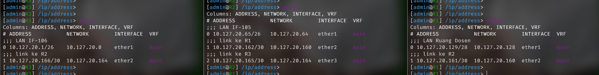                                                                   |
| 2   | Routing table awal          | `/ip route print`   | 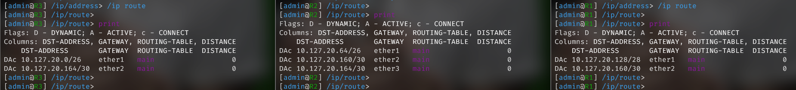                                                             |
| 3   | Hasil ping ke R2 (.162)     | `ping`              | Prediksi: Gagal, karena routing table pada router belum ada <br> 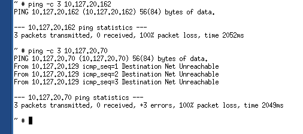 |

### Problem B.2 - Static Route Multi-Hop, Forward dan Return Path, dan Anatomi Datagram

> Pasanglah static route sesuai rencana Problem A.2 agar ketiga ruang saling terjangkau. Pemasangan dilakukan secara bertahap untuk membuktikan bahwa return route sama pentingnya dengan forward route. Selanjutnya, amati perjalanan sebuah datagram di setiap hop melalui capture Wireshark (filter `icmp`).
>
> _Install static routes according to the Problem A.2 plan so that the three rooms can reach each other. The routes are installed gradually to prove that the return route is as important as the forward route. Then observe the journey of one datagram at every hop through Wireshark captures._

**Answer:**

| No  | Parameter/Aspek                                  | Field/Perintah             | Hasil Observasi (screenshot)                                                                                                                                                              |
| --- | ------------------------------------------------ | -------------------------- | ----------------------------------------------------------------------------------------------------------------------------------------------------------------------------------------- |
| 1   | Hasil ping dan traceroute dari R3                | `ping`, `/tool traceroute` | Prediksi ping Laterano ke Kazdel: Gagal, segala koneksi ke R3 belum bisa karena belum ada routing di R3 <br> 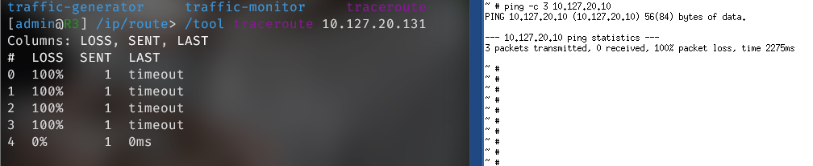 Sesudah: 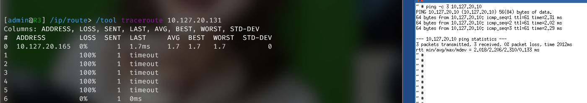 |
| 2   | Routing table R1, R2, R3 lengkap                 | `/ip route print`          | 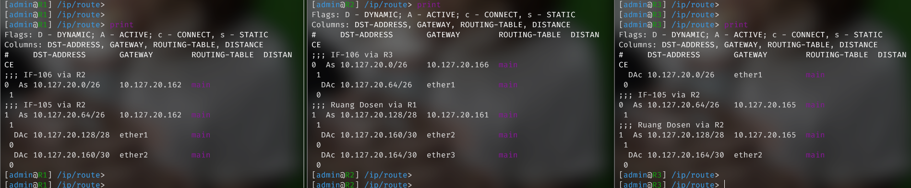                                                                                                                                                                 |
| 3   | Path Ruang Dosen → IF-105                        | `mtr`                      | 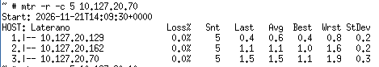                                                                                                                                                            |
| 4   | Path Ruang Dosen → IF-106                        | `mtr`                      | 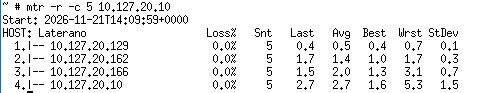                                                                                                                                                            |
| 5   | Path IF-106 → Ruang Dosen                        | `mtr`                      | 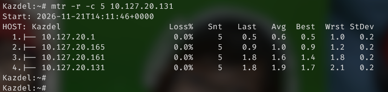                                                                                                                                                         |
| 6   | TTL pada LAN Ruang Dosen, link R1–R2, link R2–R3 | `ip.ttl`                   | 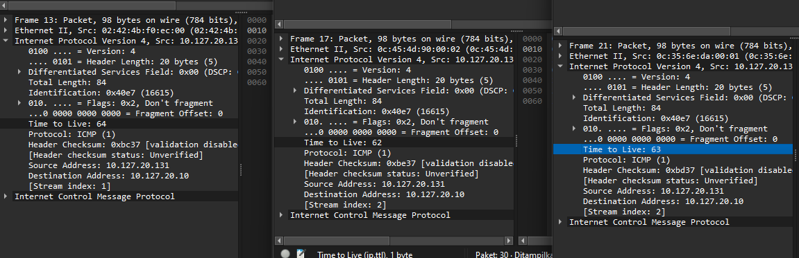                                                                                                                                                                   |
| 7   | Protocol dan Header Checksum pada ketiga capture | `ip.proto`, `ip.checksum`  | Protocol: 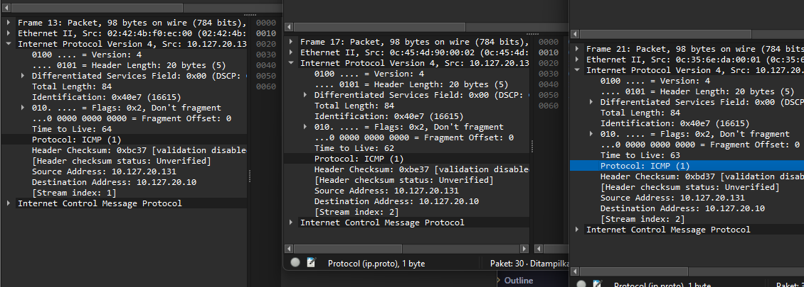 Checksum: 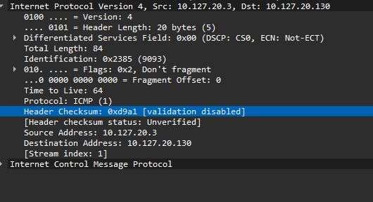 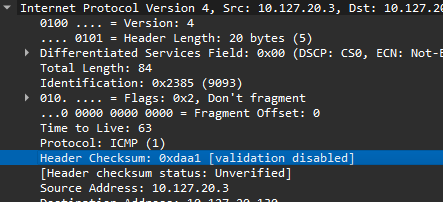 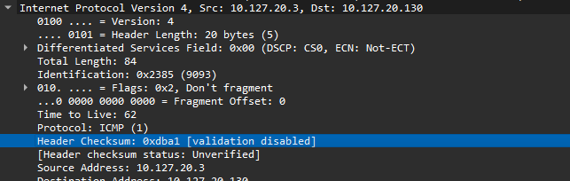                                             |

### Problem B.3 - Manipulasi Route: Summarization, Longest Prefix Match, dan Routing Loop

> Setelah seluruh ruang saling terjangkau, path datagram dimanipulasi secara sengaja untuk memahami cara router memilih route. Setiap manipulasi diawali dengan prediksi dan diakhiri dengan pengembalian konfigurasi ke kondisi semula.
>
> _After all rooms can reach each other, the datagram path is deliberately manipulated to understand how routers choose routes. Each manipulation starts with a prediction and ends by restoring the configuration to its original state._

**Answer:**

| No  | Parameter/Aspek                                         | Field/Perintah    | Hasil Observasi (screenshot)                                                                                                                                   |
| --- | ------------------------------------------------------- | ----------------- | -------------------------------------------------------------------------------------------------------------------------------------------------------------- |
| 1   | Routing table R1 setelah summarization                  | `/ip route print` | 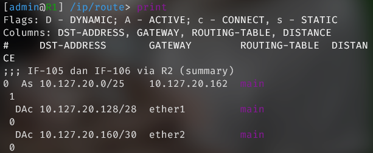                                                                                                                                   |
| 2   | Konektivitas ke IF-105 dan IF-106 setelah summarization | `ping`            | 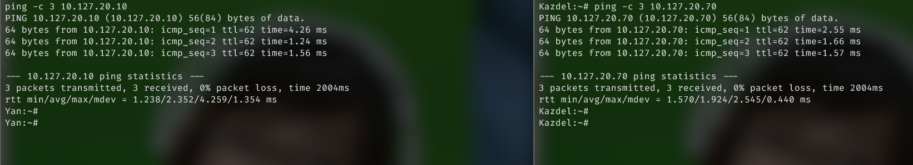                                                                                                                                       |
| 3   | Prediksi dan hasil uji LPM (.10, .1, .70)               | `ping`            | Prediksi: Hanya ping ke .10 yang gagal karena .10 disetting null/blackhole dengan prefix 32 yang mana hanya spesifik ke 1 ip yaitu .10 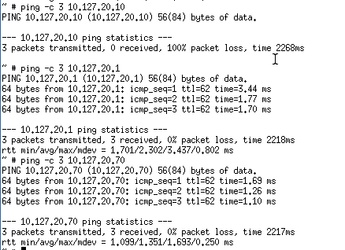 |
| 4   | Message yang diterima pengirim saat loop                | `ping`            | 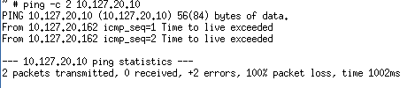                                                                                                                                  |
| 5   | Nilai TTL Echo Request yang sama pada capture R1–R2     | `ip.ttl`          | 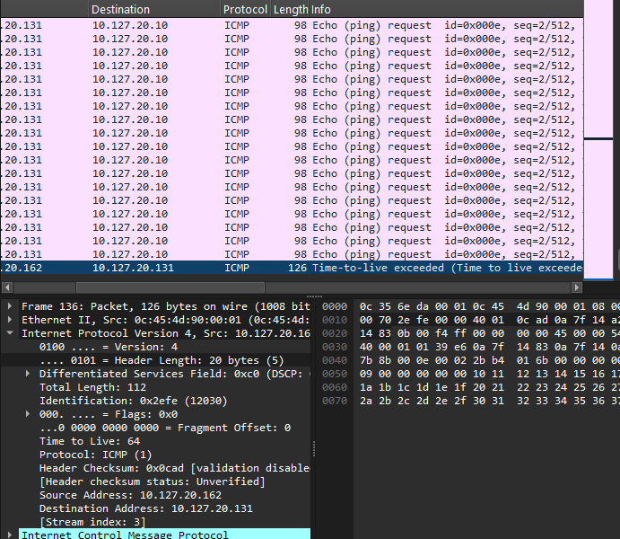                                                                                                                             |
| 6   | Konektivitas setelah konfigurasi dikembalikan           | `ping`            | 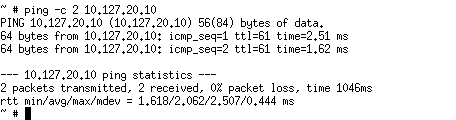                                                                                                                                     |

## Bagian C - Redundansi dan Dynamic Routing OSPF pada Topologi Ring

```
put your GNS3 topology screenshot for Part C here (Figure C.1)
```

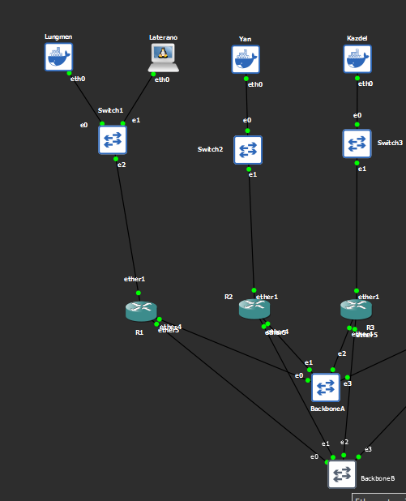

**Langkah Kerja:**

> Silahkan mengikuti langkah kerja yang diberikan dalam soal pra-praktikum modul 4 di bagian Problem C.1 dam C.2
>
> _Please follow the work steps given in the module 4 pre-practicum questions in the Problem C.1 and C.2 section_

### Problem C.1 - Redundant Link dengan Static Routing

> Pengelola jaringan menambahkan link langsung antara R3 dan R1 agar Ruang Dosen dan IF-106 memiliki path yang lebih pendek sekaligus backup path. Path baru ini terlebih dahulu dimanfaatkan dengan static routing, kemudian diuji ketika link tersebut terputus.
>
> _The network administrator adds a direct link between R3 and R1 so that the Lecturer Room and IF-106 have a shorter path as well as a backup path. The new path is first used with static routing, then tested when the link fails._

#### Langkah Kerja - (a)

**Answer:**

```
put your answer here (and screenshot) for:
- IP address configuration on R1 ether3 and R3 ether3
- static route added on R1 (IF-106 langsung via R3) and on R3 (Ruang Dosen langsung via R1, distance=10)
```

<div align="center">
    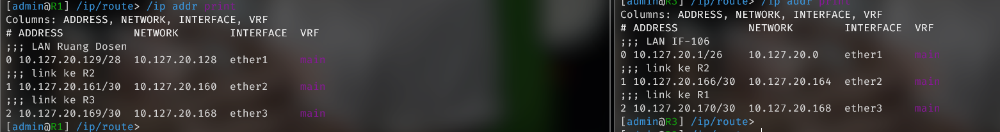
    <br>
    <p>Interface Address</p>
    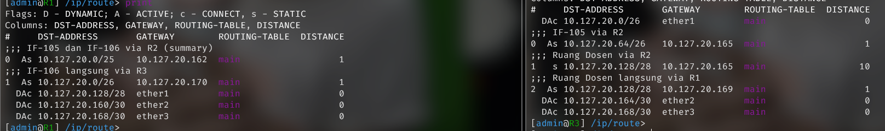
    <br>
    <p>Routing</p>
</div>

#### Langkah Kerja - (b)

**Answer:**

```
put your answer here (and screenshot) for:
- mtr path Ruang Dosen -> IF-106 (compare hop count with Problem B.2)
```

<div align="center">
    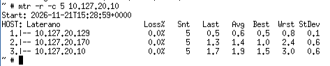
    <br>
    <p>Hop baru lebih cepat 1 hop</p>
    
    <br>
    <p>Lebih lambat pada B.2</p>
</div>

#### Langkah Kerja - (c)

**Answer:**

```
put your answer here (and screenshot) for:
- mtr from Laterano to Kazdel (route disabled on R3)
- mtr from Kazdel to Laterano (reverse direction)
```

Prediksi: Karena rute R1-R3 mati, yang diambil adalah R2-R3 melewati R2 e3 dan R3 e2 <br>

<div align="center">
    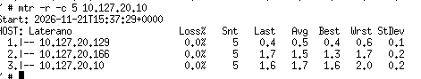
    <br>
    <p>Laterano ke Kazdel</p>
    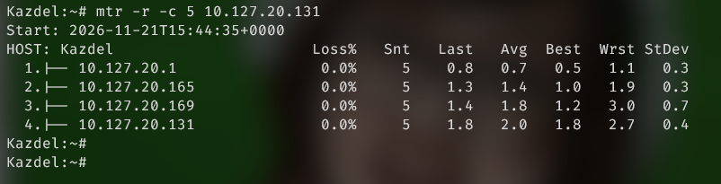
    <br>
    <p>Kazdel ke Laterano</p>
</div>

#### Langkah Kerja - (d)

**Answer:**

```
put your answer here (and screenshot) for:
- ping -O [...].10 output during suspend
- /interface print where name=ether3 (on R1)
- /ip route print where dst-address=[...].0/26 (on R1)
```

Prediksi: Seharusnya berpindah rute ke rute alternatif R1-R2 -> R2-R3

<div align="center">
    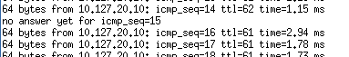
    <br>
    <p>Ping</p>
    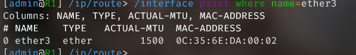
    <br>
    <p>R1 e3</p>
    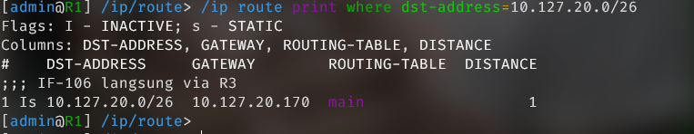
    <br>
    <p>Inactive static route</p>
</div>

#### Langkah Kerja - (e)

**Answer:**

```
put your answer here (and screenshot) for:
- check-gateway=ping configuration on R1 and R3
- recorded downtime duration before traffic switches to R2
```

<div align="center">
    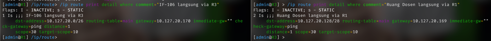
    <br>
    <p>Route detail</p>
</div>

Recorded downtime adalah 1.5ms

### Problem C.2 - OSPF pada Topologi Ring

> Seluruh static route digantikan oleh OSPF. Setiap router hanya meng-advertise interface miliknya sendiri, dan routing table dibentuk secara otomatis melalui pertukaran informasi inter-router. Amati neighbor, route yang terbentuk, serta perilaku OSPF ketika salah satu link terputus.
>
> _All static routes are replaced by OSPF. Each router only advertises its own interfaces, and the routing table is built automatically through the exchange of information between routers. Observe the neighbors, the routes formed, and OSPF behavior when one link fails._

#### Langkah Kerja - (a)

**Answer:**

```
put your answer here (and screenshot) for:
- /ip route remove [find where static]
- /ip route print (routing table containing only connected routes)
```

<div align="center">
    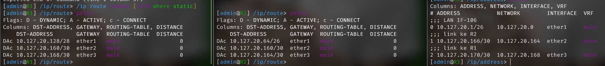
    <br>
    <p>Route detail</p>
</div>

#### Langkah Kerja - (b)

**Answer:**

```
put your answer here (and screenshot) for:
- /routing ospf instance, area, and interface-template configuration on R1, R2, R3
```

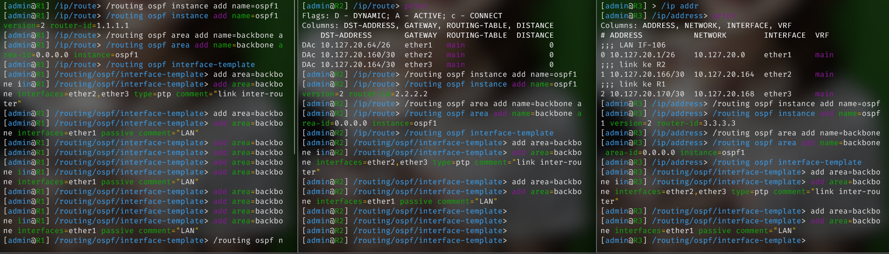

#### Langkah Kerja - (c)

**Answer:**

```
put your answer here (and screenshot) for:
- /routing ospf neighbor print
- /routing ospf interface print
- /ip route print where ospf
```

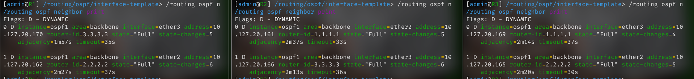
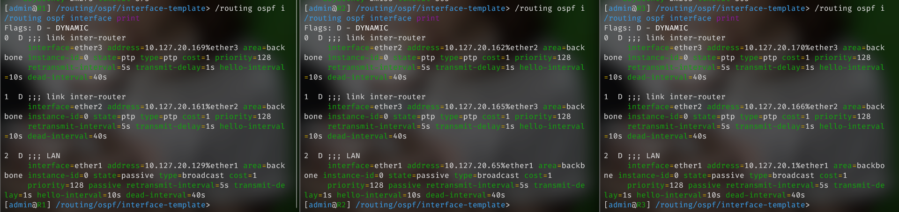
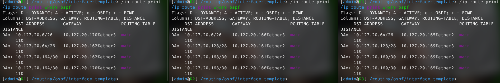

#### Langkah Kerja - (d)

**Answer:**

```
put your answer here (and screenshot) for:
- continuous ping result and recorded recovery duration
- R1 routing table and neighbor list while link is suspended
- observation after Resume (direct path returning)
```

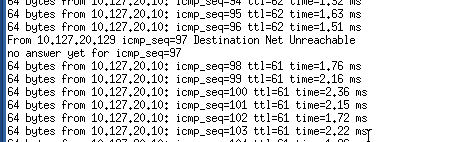
Terhitung hanya 0.25ms
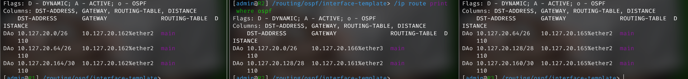
Route tidak aktif saat suspend

## Bagian D - Backbone Ganda dan Skalabilitas Dynamic Routing

```
put your GNS3 topology screenshot for Part D here (Figure D.1)
```

**Langkah Kerja:**

> Silahkan mengikuti langkah kerja yang diberikan dalam soal pra-praktikum modul 4 di bagian Problem D.1 dan D.2
>
> _Please follow the work steps given in the module 4 pre-practicum questions in the Problem D.1 and D.2 section_

### Problem D.1 - Migrasi ke Backbone Ganda

> Link point-to-point dari Bagian C dinonaktifkan dan digantikan oleh Backbone A dan Backbone B, sehingga setiap router memiliki dua uplink. Amati pemilihan DR/BDR, ECMP, dan pemulihan saat salah satu backbone terganggu.
>
> _Campus network designs commonly connect the router of each building to two shared backbones, so each router has two uplinks without needing a dedicated link between every pair of routers. The point-to-point links from Part C are disabled and replaced by Backbone A and Backbone B. Observe the DR/BDR election, ECMP, and recovery when one backbone fails._

#### Langkah Kerja - (a)

**Answer:**

```
put your answer here (and screenshot) for:
- topology after adding Backbone A and Backbone B switches and connections
```


#### Langkah Kerja - (b)

**Answer:**

```
put your answer here (and screenshot) for:
- /interface disable ether2,ether3 on R1, R2, R3
- backbone IP address configuration (ether4, ether5)
- /routing ospf interface-template addition for ether4,ether5
```

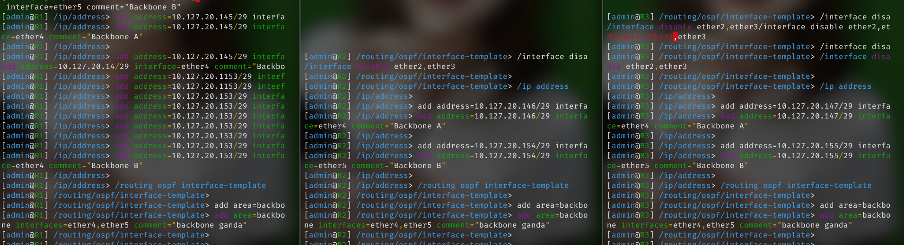

#### Langkah Kerja - (c)

**Answer:**

```
put your answer here (and screenshot) for:
- /routing ospf neighbor print
- /routing ospf interface print (DR/BDR roles on Backbone A and Backbone B)
```

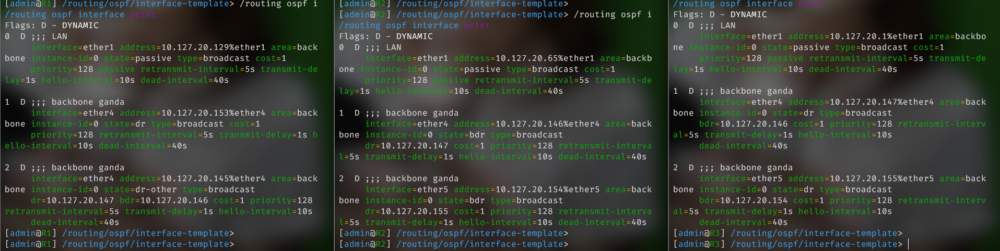

#### Langkah Kerja - (d)

**Answer:**

```
put your answer here (and screenshot) for:
- /ip route print detail where dst-address=[...].0/26 (on R1)
```

Prediksi: Kemungkinan besar 1 karena kita hanya membuat 1 instance ospf, namun bisa saja 2 jika kedua path memiliki cost sama, tetapi asumsi belum ditemukan kesamaan cost jadi hanya 1.
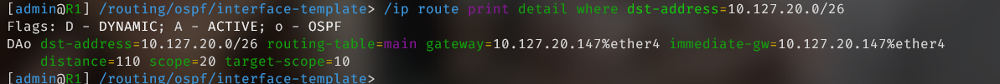

#### Langkah Kerja - (e)

**Answer:**

```
put your answer here (and screenshot) for:
- continuous ping observation during Backbone A link suspend/resume
- gateway change on R1 and downtime duration
```

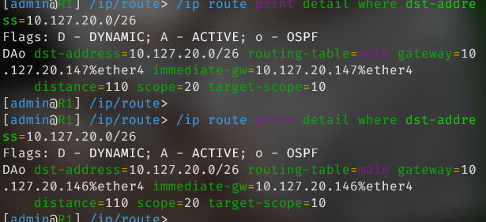
Perubahan pada ip gateway dari 147 ke 146
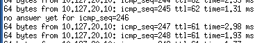
Downtime 1.5ms

#### Langkah Kerja - (f)

**Answer:**

```
put your answer here (and screenshot) for:
- priority=0 configuration on R1
- /interface disable/enable ether4,ether5
- /routing ospf interface print (R1 role before and after re-election)
```

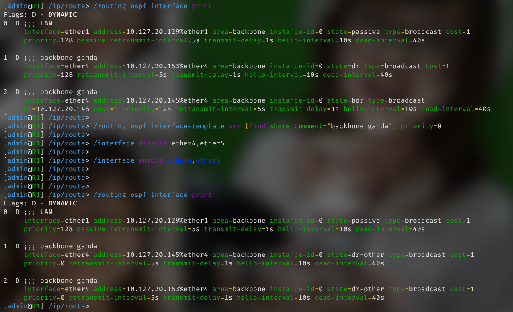
Terjadi perubahan dari dr dan bdr menjadi dr-other keduanya

### Problem D.2 - Penambahan Ruang Baca melalui R4

> Ruang Baca (±35 perangkat) ditambahkan melalui router baru R4 yang terhubung ke kedua backbone. Konfigurasi R1, R2, dan R3 tidak boleh diubah sama sekali. Buktikan bahwa Ruang Baca dapat dijangkau dari seluruh ruang hanya dengan mengonfigurasi R4.
>
> _The Reading Room (±35 devices) is added through a new router, R4, connected to both backbones. The configuration of R1, R2, and R3 must not be changed at all. Prove that the Reading Room can be reached from every room by configuring R4 only._

#### Langkah Kerja - (a)

**Answer:**

```
put your calculation here: number of additional static routes needed and on which routers
```

#### Langkah Kerja - (b)

**Answer:**

```
put your answer here (and screenshot) for:
- topology after adding R4, switch, and Higashi
- R4 IP address configuration (ether1, ether4, ether5)
- R4 OSPF instance/area/interface-template configuration
- Higashi address and default gateway configuration
```

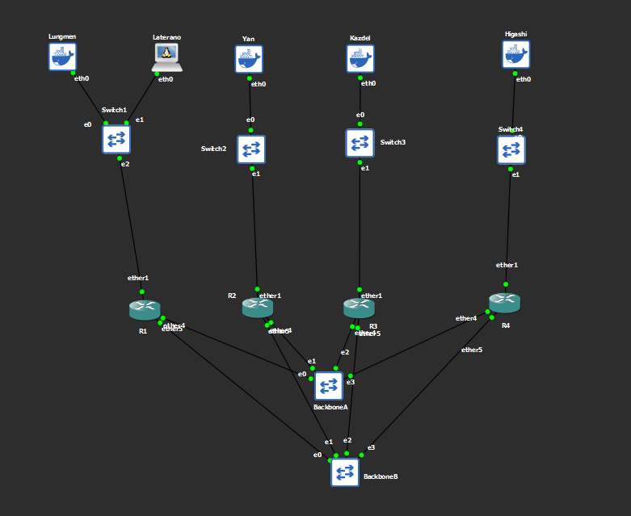
Full topo
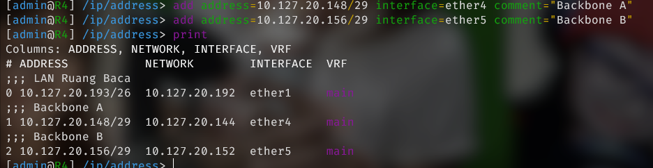
Ip address
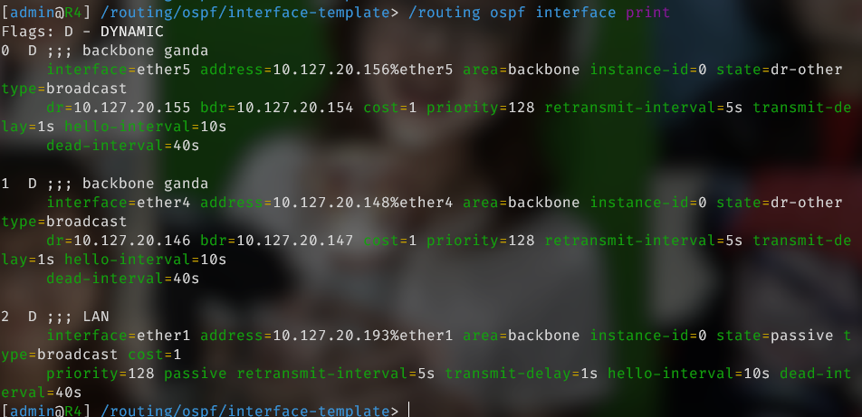
OSPF Instance
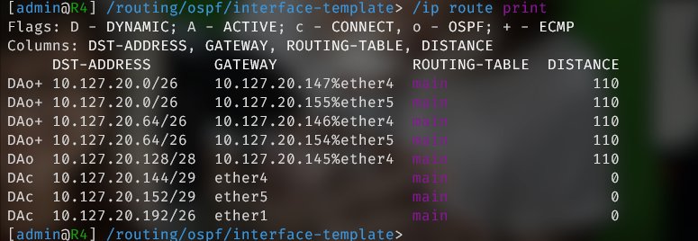
Default gateway adalah multi router, karena distance sama, keduanya digunakan.

#### Langkah Kerja - (c)

**Answer:**

```
put your answer here (and screenshot) for:
- /ip route print where dst-address=[IP Prefix].192/26 (on R1, without touching R1 config)
- mtr from Ruang Dosen (Laterano) to Higashi
```

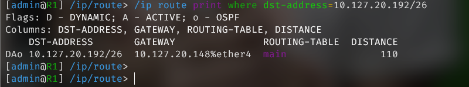
R1 detect .192/26

Traceroute berjalan baik

#### Langkah Kerja - (d)

**Answer:**

```
put your answer here (and attach files) for:
- /export file=case4-R1 (R2, R3, R4 menyesuaikan)
```


Sudah tersimpan, bisa dicek untuk R2, R3, dan R4 juga

## Tugas Mandiri

> Sebuah gedung baru memperoleh alokasi `[IP Prefix].50.0/24` untuk tiga ruang, yaitu Lab Jaringan (±60 host), Lab Sistem Cerdas (±25 host), dan Ruang Server (±6 host). Router RA, RB, dan RC yang melayani ketiga ruang tersebut disusun dalam chain topology RA–RB–RC dengan dua link point-to-point. Seluruh tahapan dikerjakan di atas kertas, **tanpa GNS3**, dengan menerapkan konsep Bagian A dan B.
>
> _A new building receives the allocation [IP Prefix].50.0/24 for three rooms: the Network Lab (±60 hosts), the Intelligent Systems Lab (±25 hosts), and the Server Room (±6 hosts). Routers RA, RB, and RC serving these rooms are arranged in a chain topology RA–RB–RC with two point-to-point links. All stages are done on paper, **without GNS3**, applying the concepts of Parts A and B._

> Detail Tugas Mandiri bisa dilihat di dokumen pra praktikum modul 4 di bagian Tugas Mandiri
>
> _Details of Independent Assignments can be seen in the module 4 pre-practicum document in the Independent Assignments section_

**Gambar Perencanaan VLSM - VLSM Planning Diagram**

```
put image here
```


**Answer - Tabel Perhitungan VLSM:**

| No  | Parameter          | Lab Jaringan (±60)              | Lab Sistem Cerdas (±25)        | Ruang Server (±6)             | Link RA–RB                   | Link RB–RC                   |
| --- | ------------------ | ------------------------------- | ------------------------------ | ----------------------------- | ---------------------------- | ---------------------------- |
| 1   | Prefix             | /26                             | /27                            | /29                           | /30                          | /30                          |
| 2   | Network Address    | 10.127.50.64                    | 10.127.50.32                   | 10.127.50.8                   | 10.127.50.0                  | 10.127.50.4                  |
| 3   | Broadcast Address  | 10.127.50.127                   | 10.127.50.63                   | 10.127.50.15                  | 10.127.50.3                  | 10.127.50.7                  |
| 4   | Rentang Host Valid | 10.127.50.65 s.d. 10.127.50.126 | 10.127.50.33 s.d. 10.127.50.62 | 10.127.50.9 s.d. 10.127.50.14 | 10.127.50.1 s.d. 10.127.50.2 | 10.127.50.5 s.d. 10.127.50.6 |

**Answer - Soal 4 (backup route via RC–RA):**

```
put your calculation and explanation here
```


AJK
